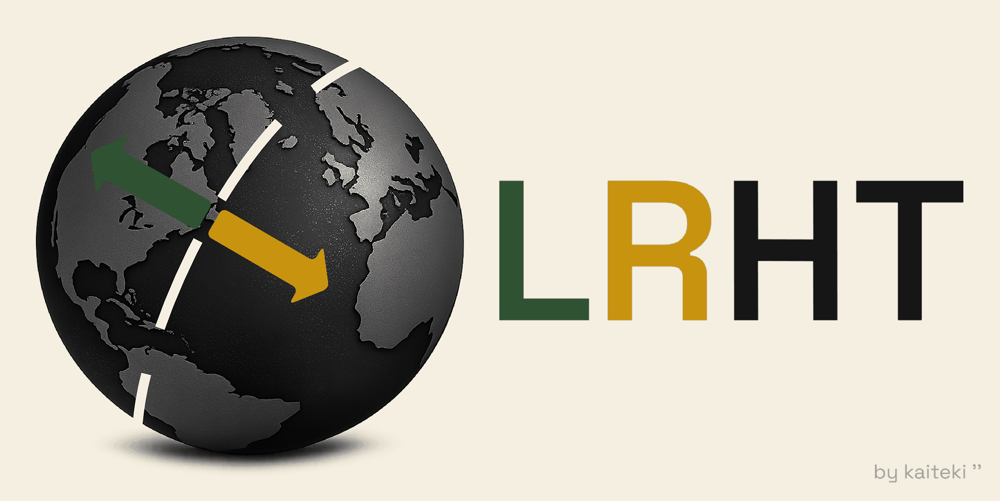
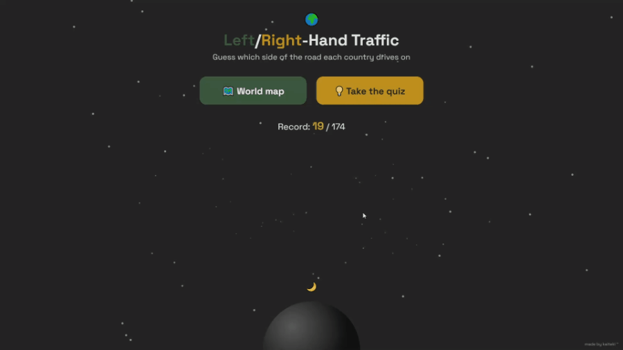
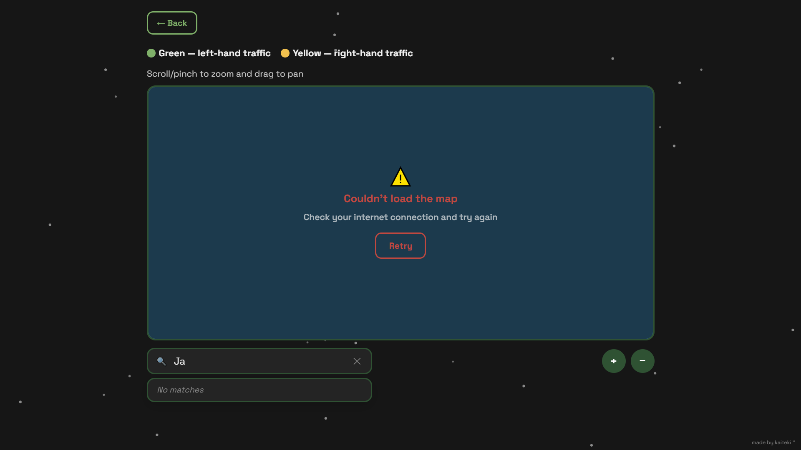

# LRHT — Which Side of the Road?

An interactive world map and quiz that shows which side of the road every country drives on — an interesting way to learn and remember how it varies by country.



**Live demo:** [kaiteki.github.io/lrht](https://kaiteki.github.io/lrht/).

## What it does

| Screen | Description |
|---|---|
| **Menu** | the starting screen, with buttons to open the map or start the quiz, plus a day/night toggle that switches the whole app between light and dark themes with a small planet, sun and moon animation |
| **Map** | a pannable, zoomable world map that shows each country in green (left-hand traffic) or yellow (right-hand traffic), with a search box to jump straight to any country; not every country has its name printed on the map itself (it would often overlap, crowd out neighbors or mislabel the territory), but hovering any country always shows its name, and searching circles its location |
| **Quiz** | guess left or right for a random country each round, with a live streak counter and a best-streak record saved on your device |



LRHT covers 174 countries — not every country in the world. A handful of very small or remote nations are left out, either because they're too tiny to render as anything more than an invisible speck at this map's scale, or because their shape simply doesn't fit how the map is drawn. Every screen change, toggle, loading and error state fades in and out smoothly, so nothing jumps or snaps anywhere in the app.

## Tech

Plain HTML/CSS/JavaScript — no framework, no build step, no dependencies to install. Map rendering uses [D3.js](https://d3js.org/) (loaded from a CDN) together with real country border data fetched at runtime from [johan/world.geo.json](https://github.com/johan/world.geo.json), pinned to a specific commit so upstream changes can't alter the map. Quiz flags try several independent CDNs in sequence, falling back automatically if one doesn't respond. On a phone, the site can be added to your home screen (via your browser's menu) to open in its own app-like window with a custom icon; the name and icons for this come from the `manifest.webmanifest` file.

**Note:** an internet connection is required — the map and quiz fetch their country-border data from the web, so on a slow connection there may be a short wait, and the app shows a loading message in the meantime. If the data can't be loaded at all (for example, when you're offline), both show an error inside the app instead.



## Running it locally

No build step needed — just open `index.html` directly in a browser.

If it doesn't load for you (some browsers restrict local pages from making network requests), serve the folder instead:
```bash
python3 -m http.server 8000
```
then open `http://localhost:8000` in your browser.

## Project structure

| File | Purpose |
|---|---|
| `index.html` | markup |
| `style.css` | all styles |
| `script.js` | app logic (map, quiz, search, theme) |
| `countries.js` | country list and traffic-side data |
| `favicon.ico, favicon-*.png, icon-*.png, apple-touch-icon.png` | favicons and app icons |
| `manifest.webmanifest` | web app manifest (name and icons for "Add to Home Screen") |
| `og-image.png` | social-media link preview image |
| `banner.png` | this README's banner |
| `demo.gif` | app walkthrough shown in this README |
| `offline-error.png` | this README's offline-error screenshot |
| `LICENSE` | MIT license |
| `README.md` | this file |

## Credits

Country border data from [johan/world.geo.json](https://github.com/johan/world.geo.json).

## License

MIT © kaiteki — see [LICENSE](LICENSE).

Thanks for reading this far — hope you enjoy using the app!
